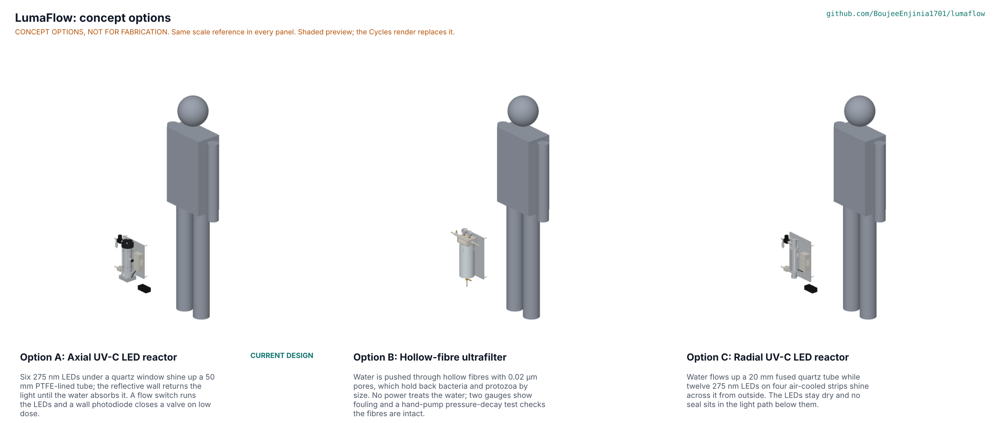

# LumaFlow concept options

Option B, a hollow-fibre ultrafilter, scores 229 and option A, the existing axial UV-C LED reactor, scores 228 of a possible 275; option C, a radial UV-C LED reactor, scores 204. A and B are within 10 % of each other, so **both go to Amish without a pick** (STANDARDS section 21), recorded as "Proposed, awaiting Amish" in LMF-DEC-001 and argued in LMF-DDR-004. Option B would change the working principle and the pitch ("inline UV-C LED reactor"), so it can only be chosen by Amish; until he decides, the repo stays on option A and nothing is redesigned. Method: STANDARDS section 21.

*Figure 1. The three options, each from its detailed model (`components()` in `cad/src/model.py`), with a 1.75 m person for scale. The picture in the repo at this version is a shaded preview; the Blender Cycles panels are rendered on the studio machine (see the review note).*

## The options

### Option A: axial UV-C LED reactor (the existing design)

Six 275 nm LEDs under a 10 mm quartz window shine up a 50 mm bore lined with high-reflectance PTFE inside a 316 tube; the wall returns about 95 % of the light that reaches it, so the water absorbs 53 % of the LED output at 90 %/cm. A Hall-effect flow sensor runs the LEDs only while water flows, a SiC photodiode in the tube wall estimates the dose and a normally closed valve stops the water on low dose, fault, open lid or power loss. This is the design of LMF-PRC-001, made constructable in LMF-DDR-003; nothing about it changes in this document except the four STEM fixes (expanded PTFE seals, ring screws in anti-seize at 0.21 N·m, an outlet pressure sensor that starts the unit, and an alarm threshold weighted for 275 nm).3 N·m ring screws). First-order numbers: RED 50.9 to 74.9 mJ/cm² at 90 %/cm and 1.2 L/min (47.3 with the 275 nm response factor), 22.6 W while flowing, 0.23 W standby, USD 433. Key risks: the liner's wetted reflectance (S8), the dose rule in firmware (PR-004), light through the PTFE onto the acetal cap (S10). From a co-design partner it needs real UVT data from wells and a lab for biodosimetry.

### Option B: hollow-fibre ultrafilter

Water from the cold line passes through a 2.5 x 10 in (slim) filter housing holding a hollow-fibre ultrafiltration cartridge (PVDF, about 0.02 µm pores, about 0.8 m² of membrane). The fibres hold back bacteria and protozoan cysts by size; no power treats the water. Two 40 mm gauges on the head show inlet and outlet pressure, so a rising difference shows fouling; a ball valve on the bowl drain gives a forward flush; a Schrader valve on the inlet tee lets the user run an air pressure-decay test with a hand pump to check that no fibre has broken. A folded 316 bracket holds the head on the same kind of 6 mm aluminium wall plate as option A. First-order numbers: 1.2 L/min needs a clean-water permeability of about 180 L/(m² h bar) at 0.5 bar (B1, to confirm); no electricity; about 460 mm tall with gauges and drain line, over the 350 mm envelope (PR-014); first-order cost USD 120 to 180 (an estimate, not a priced BOM; a complete commercial under-sink UF system lists at CAD 125.99, see LMF-MKT-001). Key risks: no automatic alarm on a broken fibre (PR-004 would be redesigned around a manual test), virus removal only partial (B3), cartridge replacement and fouling with iron-rich well water, and a change of pitch. From a co-design partner it needs water-quality data on fouling and a lab able to run integrity and challenge tests.

### Option C: radial UV-C LED reactor

Water flows up a 20 mm fused quartz tube (24 mm outside, 2 mm wall) between two flanged 316 end fittings; twelve 275 nm LEDs on four aluminium-core strips, each on a finned aluminium bar, shine across the tube from outside, with polished aluminium reflectors in the corners. The LEDs stay dry, no seal sits under the LEDs in the light path, and the quartz tube can be wiped without draining a cap. Heat leaves through the fins and, while water flows, through the bars and flanges into the end fittings and the water (C4). It reuses option A's flow sensor, valve, controller, enclosure and plate; the photodiode looks across the tube through a gap in one reflector. First-order numbers: average dose about 100 mJ/cm² at 90 %/cm (C1), RED to be ray-traced (C2), about 39 W from the mains while flowing (twelve LEDs), 355 mm tall, 5 mm over the envelope; first-order cost USD 400 to 450 (estimate from option A's BOM lines it reuses plus twelve LEDs at option A's per-LED estimate; the quartz tube and fittings are unpriced). Key risks: power over PR-009, a sensor that sees direct LED light and so reads UVT less directly (C6), UV-C leakage paths at the bar gaps.

## First-order numbers

Table 1. Options compared. Part counts and masses from `cad/fidelity.json` (masses use the kit's material densities, which lack PTFE, acetal, quartz and PETG, so they read low; LMF-CAL-001 H2 gives 4.97 kg for option A).

| Quantity | Option A | Option B | Option C |
| --- | --- | --- | --- |
| Estimated parts cost (USD) | 433 (priced BOM) | 120 to 180 (estimate) | 400 to 450 (estimate) |
| Mass (kg), fidelity check | 4.7 | 3.3 | 3.7 |
| Output or throughput | 1.2 L/min; RED 50.9 to 74.9 mJ/cm² at 90 %/cm | 1.2 L/min at about 0.5 bar TMP (to confirm) | 1.2 L/min; average dose about 100 mJ/cm² |
| Energy or effort | 22.6 W flowing, 0.23 W standby, 3.9 kWh/year | None for treatment; manual flush and test | About 39 W flowing |
| Parts count (model) | 119 (65 made or bought, 53 fasteners, 1 weld) | 36 (26 made or bought, 10 fasteners) | 132 (68 made or bought, 64 fasteners) |
| Treats viruses | About 0.5 log (not a claim) | Partly (not credited) | About 0.5 log at the same dose |
| STEM check | Within known science after fixes D-S1, D-S2; S6, S7, S10 plausible | Within known science; B1, B3, B5 plausible | Within known science; C2, C6 plausible |

## Scoring

Table 2. Weighted scoring (weights: High UR 3, Medium 2, Low 1; scores 1 to 5).

| Criterion | Source | Weight | A | B | C | Reason |
| --- | --- | --- | --- | --- | --- | --- |
| Safer water at one tap | UR-001 | 3 | 4 | 5 | 3 | B removes bacteria and cysts by size if intact; A meets the dose on paper with an 18 % margin; C's RED is not yet traced |
| Useful flow | UR-002 | 3 | 5 | 4 | 5 | B's flow falls as the membrane fouls |
| Poorer water | UR-003 | 2 | 2 | 4 | 2 | UF does not depend on UVT; A and C stop the water below about 89 %/cm |
| No silent failure | UR-004 | 3 | 4 | 2 | 3 | A closes a valve on its sensor; B relies on gauges and a manual test; C's sensor reads UVT less directly |
| Instant on | UR-005 | 3 | 5 | 5 | 5 | All treat from the first drop |
| No mercury | UR-006 | 3 | 5 | 5 | 5 | None uses a lamp |
| Household pressure | UR-007 | 3 | 4 | 4 | 3 | A's window has a 9 % margin at 8 bar; B's housing is a catalogue part; C's quartz tube is in tension |
| Tap pressure | UR-008 | 2 | 5 | 3 | 5 | B adds up to 0.5 bar, more as it fouls |
| Low running energy | UR-009 | 2 | 4 | 5 | 2 | C draws about 39 W |
| Long life | UR-010 | 2 | 4 | 3 | 4 | B's cartridge is replaced every year or two |
| Nothing added | UR-011 | 3 | 4 | 4 | 4 | All food-contact; A's acetal cap behind PTFE to verify; B's membrane grade to certify |
| No UV exposure | UR-012 | 3 | 4 | 5 | 3 | B has no UV; C has more gaps to close |
| Electrical safety | UR-013 | 3 | 5 | 5 | 5 | 24 V or no power |
| Fits under the sink | UR-014 | 3 | 5 | 2 | 4 | B is about 460 mm tall with its gauges and drain; C is 355 mm tall, 5 mm over the 350 mm envelope |
| Easy service | UR-015 | 2 | 4 | 4 | 3 | B is a cartridge swap; C's strips need the cage opened |
| Affordable and buildable | UR-016 | 2 | 2 | 5 | 2 | B is mostly bought parts |
| Status at a glance | UR-017 | 2 | 5 | 3 | 5 | B shows pressure, not treatment |
| Honest claims | UR-018 | 3 | 5 | 5 | 5 | Same documentation rules for all |
| Cost against the value-engineering target | PR-016 | 2 | 2 | 5 | 2 | A USD 433 and C about USD 430 against USD 340; B well under |
| Buildable with local skills and tools | | 2 | 3 | 5 | 3 | A and C need a machine shop for 316 parts |
| Safety | | 3 | 4 | 5 | 3 | B has no UV-C, no LED heat; C has the most UV-C paths |
| Maintenance | | 1 | 4 | 2 | 4 | B needs flushing and cartridges |
| **Weighted total** | | | **228** | **229** | **204** | Maximum 275 |

## Recommendation

A and B are within 10 % (228 against 229), so both go to Amish without a pick. The choice is really between two products: A is the open UV-C LED reactor the repo was created to document, with an automatic alarm and valve, at USD 433; B is a cheaper, unpowered, mostly bought filter that also handles cloudier water but cannot raise an alarm on its own, is taller than the cabinet envelope and changes the pitch. If Amish keeps A, the best idea to graft from B is its **pressure-decay style self-check made automatic**: A already has a normally closed valve and a flow sensor, so the controller could confirm on every idle pulse that no water passes with the valve shut (a leak or stuck valve check), at no extra parts cost. If Amish chooses B, the best idea to graft from A is the **flow-switched, normally closed valve with an alarm**, driven by a differential pressure sensor so that a sudden drop in pressure difference (a broken fibre) closes the water. Option C is not recommended: it uses more power and more LEDs for a dose that still needs a ray trace, and its one advantage, dry LEDs with no seal in the light path, is now matched in A by the expanded PTFE gasket.
